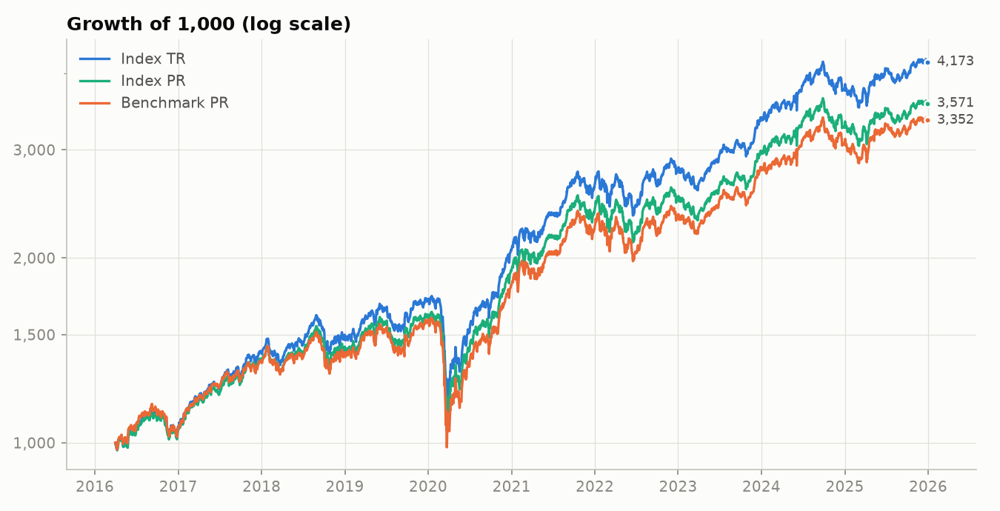
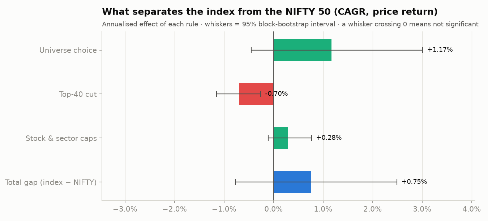
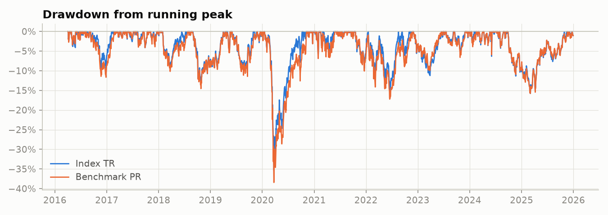
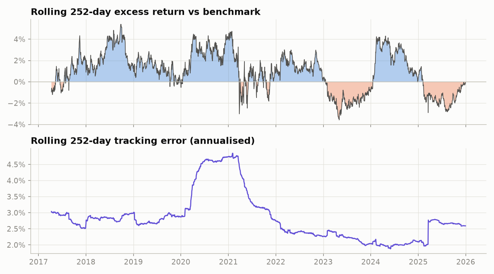
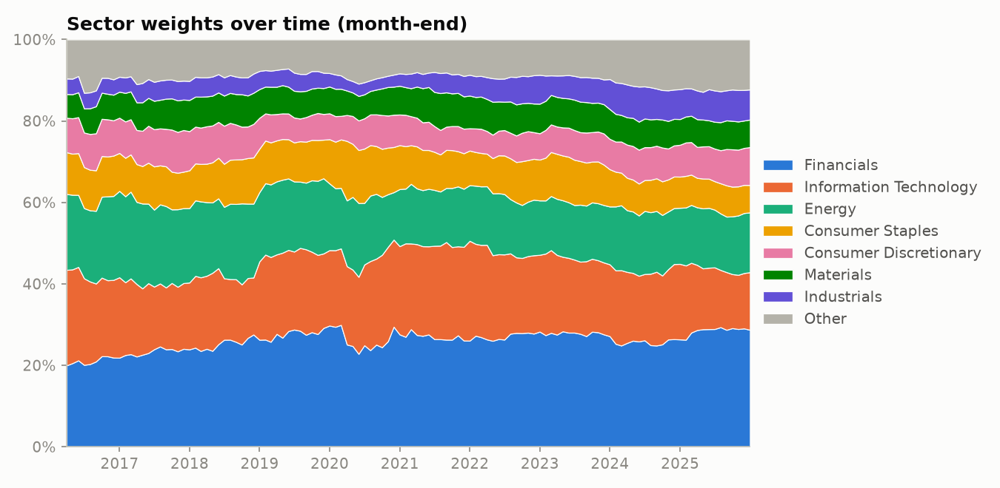
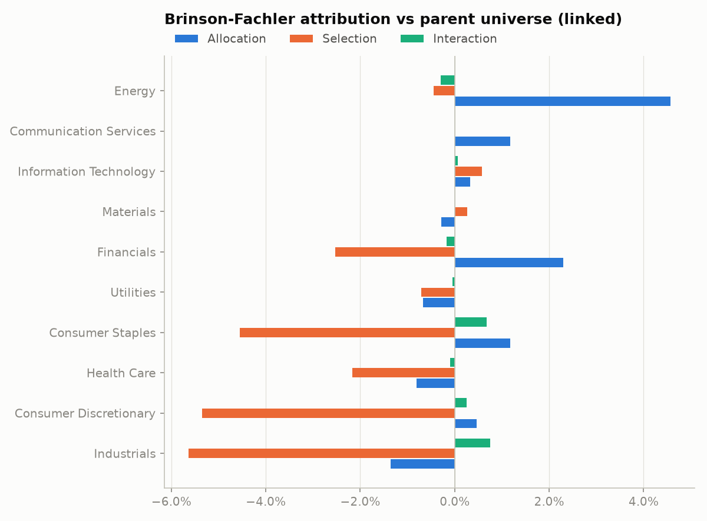
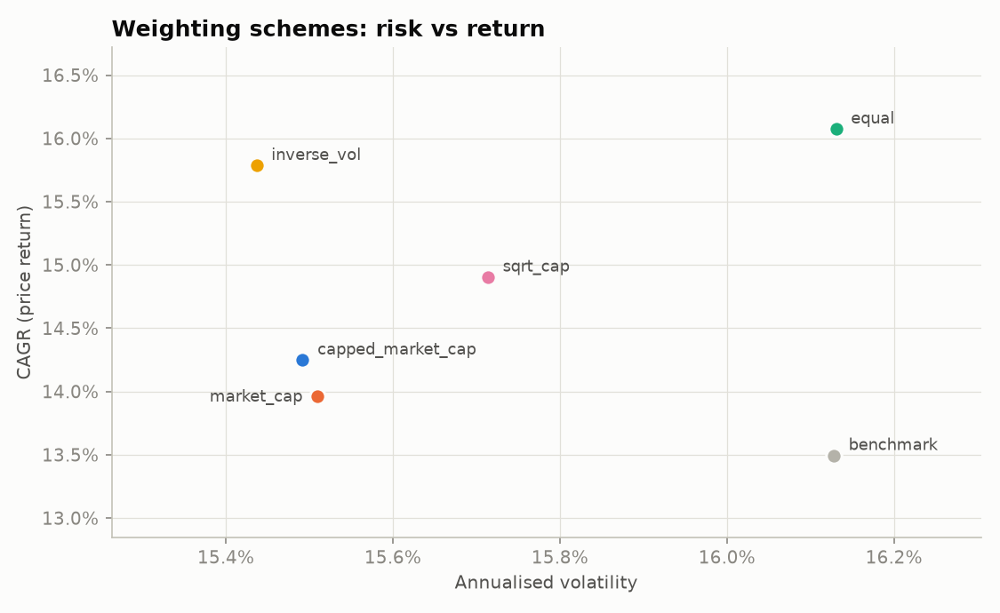
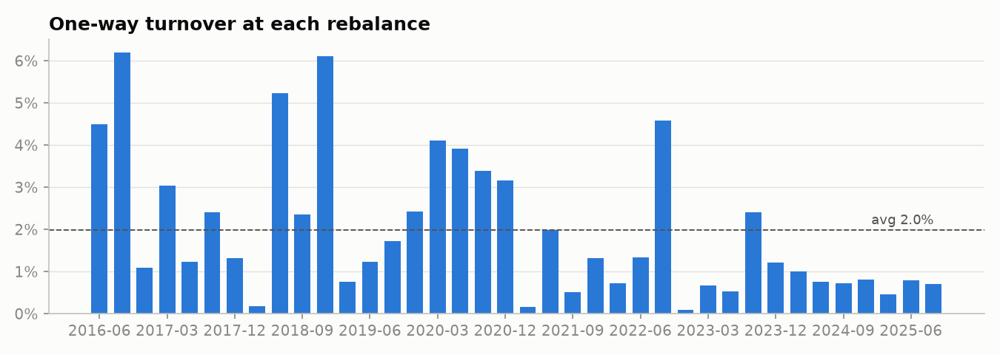

# Equity Index Engine — India Large-Cap 40


**A 40-stock, capped market-cap weighted index of NSE large caps, selected from a fixed list of 56 candidates, weighted on full market cap, and back-tested from 2016 to 2025 against the NIFTY 50.**

The index is calculated the way index providers (NSE Indices, S&P DJI, MSCI) do it: **index shares and a divisor**, with the divisor reset at every quarterly rebalance so the level stays continuous. The framework is **free-float-ready**: it can weight on free-float market cap when point-in-time free-float data is supplied, but the results below use **full market cap** because historical free-float data was not available.



<!-- RESULTS:START (written automatically by `python -m index_engine --source yahoo`) -->

### Headline results

Real NSE data (Yahoo Finance), 2016-03-31 → 2025-12-30. A 40-stock index selected from a fixed list of 56 current large caps (55 with data), weighted on **full market cap (IWF = 1: no historical free-float data)**, with 10% stock and 35% sector caps. Like-for-like: index **price return** vs NIFTY 50 **price return**.

| Metric (price return) | Index | NIFTY 50 |
|---|---:|---:|
| CAGR | 14.25% | 13.49% |
| Annualised volatility | 15.49% | 16.13% |
| Sharpe ratio | 0.52 | 0.46 |
| Maximum drawdown | -35.81% | -38.44% |
| Beta / tracking error vs NIFTY 50 | 0.95 / 2.90% | – |

**Interpretation.** The index's CAGR was 0.75 percentage points a year higher than the NIFTY 50's, with lower realised volatility. The block-bootstrap 95% interval for the gap is [-0.77%, 2.49%], which includes zero: the data are consistent with anything from modest underperformance to meaningful outperformance, so the result is **not statistically conclusive**. Splitting the gap by rule: universe choice +1.17% (not significant); top-40 cut -0.70% (significant); stock & sector caps +0.28% (not significant). The universe-choice step reflects the fixed list of today's large caps, so it likely includes survivorship bias. None of this is evidence of a repeatable edge.

Total return is **not** benchmarked here (no NIFTY 50 TRI supplied); the index's TR of 16.13% must not be compared with the NIFTY's price return. Net-of-cost CAGR by cost assumption: 10 bps: 16.10%, 25 bps: 16.07%, 50 bps: 16.03%. Validation: 9/9 run-time checks passed.

Full report: [`reports/yahoo/report.md`](reports/yahoo/report.md)

<!-- RESULTS:END -->

**How to read these results.** This is a *fixed-candidate-universe study*, not a reconstruction of a historical index: the candidates are today's large caps, so survivorship bias is likely, and weights use full market cap (investable weight factor = 1). Comparisons are like-for-like: price return vs price return, and total return only vs the NIFTY 50 Total Returns Index when supplied. A seeded synthetic market is bundled so the code runs offline and in CI.

---

## What it does

| Stage | Detail |
|---|---|
| **Universe & eligibility** | A fixed list of 56 NSE large-cap candidates across 10 sectors, from which 40 are selected (not the full NSE universe or historical index membership; see limitations). Point-in-time screens: price on the reference date, ≥ 6 months of trading history, minimum median daily traded value, valid sector. |
| **Selection** | Top 40 by float-adjusted market cap, with a **rank buffer** (incumbents keep their seat down to rank 48) to cut turnover from names flickering around the cutoff. |
| **Weighting** | Market cap × investable weight factor (IWF) with an **iterative 10% single-stock cap and 35% sector cap**. IWF = 1 unless a point-in-time shareholding file is supplied. Four alternative schemes (uncapped, equal, inverse-volatility, √cap) for comparison. |
| **Index calculation** | Divisor-based price-return (PR) level, gross total-return (TR) with dividend reinvestment, and an investable **NET** series charged transaction costs on actual rebalance turnover, with a 10 / 25 / 50 bps cost sensitivity. |
| **No look-ahead in selection** | Selection and weights use data snapshotted 5 trading days before the effective date; shareholding patterns are used only 21 days after their quarter-end (publication lag). |
| **Analytics** | CAGR, volatility, Sharpe, Sortino, Calmar, max drawdown (with recovery), VaR/CVaR, skew/kurtosis, beta, Jensen's alpha, tracking error, information ratio, up/down capture, rolling 1-year beta/TE/excess return, calendar-year returns. |
| **Like-for-like benchmarks** | Price return vs NIFTY 50 price return; total return (net of costs) vs the NIFTY 50 Total Returns Index when supplied, otherwise not benchmarked. |
| **Significance** | **Moving-block bootstrap** confidence intervals on the active return and on each rule's effect. |
| **What drives the result** | A **rules bridge** splits the gap vs the NIFTY 50 into universe choice, the top-40 cut and the caps, each with a 95% interval; a period check shows whether the gap depends on one year. |
| **Attribution** | **Brinson-Fachler** sector attribution per holding period, **Carino-linked** so effects sum exactly to the cumulative active return. |
| **Validation & provenance** | Every run reconciles its own outputs (weights, caps, divisor, dividends, costs, attribution) and reports how much index weight rests on genuinely point-in-time share counts. A `run_log.json` records versions, config hash and data-file hashes for reproducibility. |
| **Engineering** | Typed config, cached data layer with batched, retrying downloads, vectorised calculation, unit tests run in GitHub Actions CI. |

---

## Quick start

```bash
git clone https://github.com/monisha-jasrai/Equity-Index-Engine.git
cd Equity-Index-Engine
python3 -m venv .venv && source .venv/bin/activate     # Windows: python -m venv .venv && .venv\Scripts\activate
pip install -r requirements.txt

python -m index_engine --source yahoo        # real NSE data (downloads once, then cached)
python -m index_engine --source synthetic    # fully offline demo
python -m pytest -q                          # unit tests
```

Useful overrides: `--scheme equal`, `--frequency monthly`, `--refresh` (force re-download).

**Optional total-return benchmark.** Download the NIFTY 50 Total Returns Index history as CSV from [niftyindices.com](https://www.niftyindices.com) (Historical Data → Total Returns Index), save it as `data/nifty50_tri.csv`, and set `benchmark_tri_file: data/nifty50_tri.csv` in the config. The report then adds a total-return vs total-return comparison.

Each run writes to `reports/<source>/`:

| File | Contents |
|---|---|
| `report.md` | Tear sheet: metrics, charts, attribution, rebalance log, **validation**, **data provenance and limitations** |
| `run_log.json` | Timestamp, command, git commit, package versions, config + data-file hashes, provenance, every check result |
| `index_levels.csv` | Daily PR / TR / NET levels, benchmark, divisor |
| `rebalance_log.csv` | Every rebalance: adds, deletes, turnover, cost, divisor, concentration |
| `current_constituents.csv` | Latest holdings with target/current weights, capping factors, index shares |
| `attribution_by_period.csv` | Brinson-Fachler effects per sector per holding period |
| `variant_comparison.csv` | Weighting-scheme comparison |
| `rules_bridge.csv` | Effect of each rule on the gap vs the NIFTY 50, with 95% intervals |
| `cost_sensitivity.csv` | Net CAGR at 10, 25 and 50 bps |
| `summary.json` | Headline results, weighting basis, checks passed |

---

## Methodology

### 1. Index level and the divisor

```math
\text{Level}_t = \frac{\sum_i q_i \, P_{i,t}}{D}, \qquad q_i = \text{Shares}_i \times \text{IWF}_i \times \text{CF}_i
```

* $q_i$ — **index shares**: shares outstanding × investable weight factor × capping factor, frozen between rebalances.
* $\text{CF}_i$ — **capping factor**, scales a stock's index shares so its weight equals the capped target (largest CF = 1).
* $D$ — **divisor**, reset at each rebalance so the level is unchanged by the reconstitution:

```math
D_{\text{new}} = D_{\text{old}} \times \frac{MV_{\text{new}}}{MV_{\text{old}}}
```

### 2. Free float (IWF)

Only shares available to public investors should count. The engine supports a **time-varying IWF**:

* **Default (Yahoo only):** IWF = 1, i.e. full market cap. Reports label this explicitly.
* **With a shareholding file** (`data.shareholding_file` in the config): a CSV with columns `date, ticker, shares_outstanding, promoter_holding_pct`, one row per company per quarter (e.g. exported from Capitaline).
  * IWF = 1 − promoter holding. NSE also excludes some other locked-in holdings, so this approximates the official factor.
  * Each record is used only **21 days after its quarter-end** (the publication lag), never earlier.
  * Dates before a company's first record are **not back-filled** from later data.
  * As-reported share counts are **restated for later splits/bonuses** so they match the split-adjusted price series.

### 3. Price, total and net return

* **PR**: the level above. Dividends are ignored.
* **TR**: $TR_t = TR_{t-1} \cdot \frac{\sum_i q_i (P_{i,t} + d_{i,t})}{\sum_i q_i P_{i,t-1}}$ — cash dividends reinvested across the index on the ex-date.
* **NET**: TR × $(1 - c)$ at each rebalance, $c = \text{bps} \times \sum_i |w_i^{\text{new}} - w_i^{\text{drifted}}|$, i.e. cost charged on total notional traded (buys + sells); one-way turnover is half the sum. The report shows the net return at 10, 25 and 50 bps.

**Caps apply at rebalances.** Between rebalances index shares are fixed, so a capped stock can drift above 10% as its price rises; the next rebalance resets it. The report measures this drift (largest weight just before each rebalance), so a current weight above 10% is expected, not a capping failure.

Benchmark comparisons are strictly like-for-like: **index PR vs NIFTY 50 PR** (the Yahoo series is a price index), and **index NET vs NIFTY 50 TRI** only when a TRI file is supplied. Comparing the index's TR with a price index would flatter it by roughly the dividend yield (~1.5% a year), so the engine never does it.

### 4. Selection with a buffer

Eligible stocks are ranked by float-adjusted market cap at the reference date. Incumbents ranked ≤ 48 are retained; remaining seats go to the highest-ranked non-members.

### 5. Capping algorithm

Alternating projections: cap stocks above 10% and spread the excess pro rata over names with room under both caps; cap sectors above 35% and spread the excess over names in sectors below the cap; repeat until both hold (capping cascades, so it must iterate). Feasibility is checked up front.

### 6. What drives the result: the rules bridge

The gap between the index and the NIFTY 50 (price return, CAGR) is split into the effect of each rule, by running the same engine with rules switched off:

| Step | Comparison | What it isolates |
|---|---|---|
| Universe choice | all eligible candidates (uncapped) − NIFTY 50 | the fixed candidate list; this is where survivorship bias shows up |
| Top-40 cut | top-40 uncapped (with buffer) − all candidates | selecting only the 40 largest |
| Stock & sector caps | top-40 capped − top-40 uncapped | the 10% / 35% caps |

The steps are differences of CAGRs, so they sum exactly to the total gap (tested). Each has a 95% moving-block bootstrap interval; an interval crossing zero means the effect is not statistically distinguishable from zero. A period check reports how many calendar years the index beat the NIFTY and the gap with the best year removed.

### 7. Attribution

Brinson-Fachler against the **parent universe** (all eligible names, uncapped), **not the NIFTY 50**: sector-level attribution needs the benchmark's stock weights at every rebalance, which are not available for the NIFTY 50. It isolates what the index rules (top-40 cutoff and caps) did, by sector. A negative result here can coexist with a positive gap vs the NIFTY 50; the rules bridge (section 6) links the two benchmarks.

```math
\text{Alloc}_s = (w^I_s - w^B_s)(r^B_s - R^B), \quad
\text{Sel}_s = w^B_s (r^I_s - r^B_s), \quad
\text{Inter}_s = (w^I_s - w^B_s)(r^I_s - r^B_s)
```

Computed per holding period and linked with **Carino smoothing** so the effects sum to the cumulative active return.

---

## Validation

Two layers, because passing unit tests doesn't prove that real market data behaved as assumed.

**Unit tests** (`python -m pytest`, run in CI on every commit) check the logic on controlled inputs: capping (including cascades and infeasible caps), divisor continuity, weights summing to one, TR ≥ PR, NET = TR at zero cost, the buffer reducing turnover, the rebalance calendar, attribution reconciliation, analytics on known series, the shareholding loader's publication lag and no back-fill, split restatement, that a full-market-cap run is never labelled free-float, that total return is never benchmarked against a price index, the TRI file loader, and that the rules bridge sums exactly to the total gap.

**Run-time checks** (every backtest, shown in `report.md` and `run_log.json`) reconcile the actual outputs:

| Check | What it verifies |
|---|---|
| Weights sum to 100% | daily and at every rebalance |
| Single-stock and sector caps | every rebalance's target weights |
| Divisor continuity | new basket ÷ new divisor = old basket ÷ old divisor at each rebalance |
| Dividends reconcile | daily TR − PR equals dividends rebuilt independently from index shares |
| Costs reconcile | final NET ÷ TR equals Π(1 − cost) across rebalances |
| Attribution reconciles | effects sum to active return; attribution index return equals the PR level |
| Lagged selection | every rebalance uses data ≥ 5 trading days old |

**Data provenance** (also in the report): the share of index weight, averaged over rebalances, that rests on point-in-time share counts versus back-filled or current counts (both look-ahead), and on known versus default IWFs. Prices and volumes (and so the liquidity screen) are daily and point-in-time.

---

## Charts (real NSE data)

**What separates the index from the NIFTY 50.** Each rule's effect on the CAGR gap, with 95% bootstrap intervals.



**Drawdowns** (price return vs price return).



**Rolling one-year excess return and tracking error.**



**Sector weights over time.**



**Sector attribution vs the parent universe** (not the NIFTY 50).



**Weighting schemes compared.**



**Turnover at each rebalance.**



Full tear sheet, including validation, data provenance, cost sensitivity and cap drift: [`reports/yahoo/report.md`](reports/yahoo/report.md).

---|---|
|  |  |
|  |  |
|  |  |


Full tear sheet, including validation and provenance: [`reports/yahoo/report.md`](reports/yahoo/report.md).

---

## Limitations

* **Small, fixed universe.** 40 stocks are chosen from a fixed list of 56 current large caps, not from the full NSE universe.
* **Survivorship bias (separate from look-ahead bias).** The reference-date lag prevents look-ahead *within* the rules, but the candidate list itself is today's large caps. Companies that were large in 2016 and later shrank or delisted are missing, which flatters returns. Fix: historical index-constituent lists (point-in-time membership).
* **Free float.** Reported real-data results use IWF = 1 (full market cap). Supplying a shareholding file makes the index genuinely free-float weighted.
* **Share counts.** Yahoo's share history is patchy. Where it starts late, earlier dates are back-filled; where it's missing, today's count is used. The report quantifies how much index weight this affects.
* **Benchmark.** The NIFTY 50 price index from Yahoo; a total-return comparison requires supplying the NIFTY 50 TRI (see Quick start).
* **No repeatable edge is claimed.** One ten-year window on a fixed candidate list describes how the rules behaved in that period; it does not show they will outperform.
* **Corporate actions.** Splits/bonuses via split-adjusted prices (and restatement of shareholding-file counts); spin-offs and rights issues are not modelled explicitly.

---

## Project structure

```
Equity-Index-Engine/
├── config/india_large_cap_40.yaml   # the complete index methodology
├── index_engine/
│   ├── config.py        # typed, validated config
│   ├── data.py          # Yahoo loader, shareholding-file loader, provenance, synthetic market
│   ├── universe.py      # eligibility screens, buffered selection
│   ├── weighting.py     # cap-weighting, iterative capping, alt. schemes, concentration
│   ├── engine.py        # divisor-based PR / TR / NET calculation, rebalancing, costs
│   ├── analytics.py     # risk/return, relative stats, rolling, block bootstrap
│   ├── attribution.py   # Brinson-Fachler + Carino linking, contributions
│   ├── validation.py    # run-time reconciliation checks, provenance, run log
│   ├── report.py        # charts and Markdown tables
│   ├── pipeline.py      # end-to-end run
│   └── __main__.py      # CLI
├── tests/               # unit tests
└── reports/             # generated output (yahoo = real data, synthetic = offline demo)
```

## Roadmap

* Point-in-time shareholding data from Capitaline → a genuinely free-float weighted backtest.
* Historical NIFTY 100 constituent lists → a survivorship-bias-free version alongside the fixed-candidate study.
* Supply the NIFTY 50 TRI by default for a TR vs TRI comparison.
