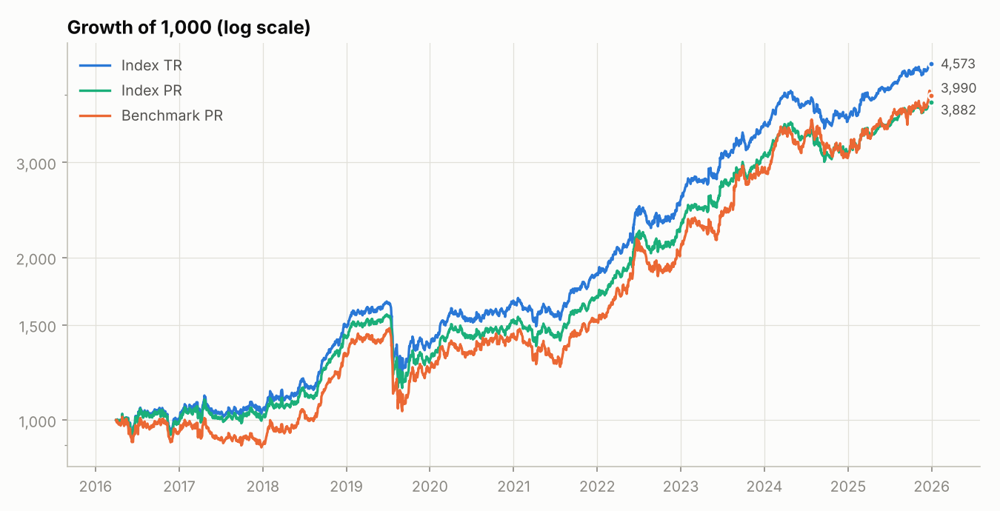
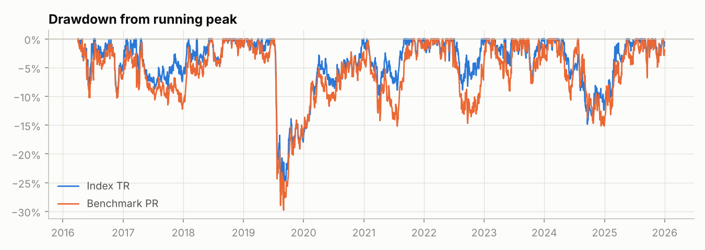
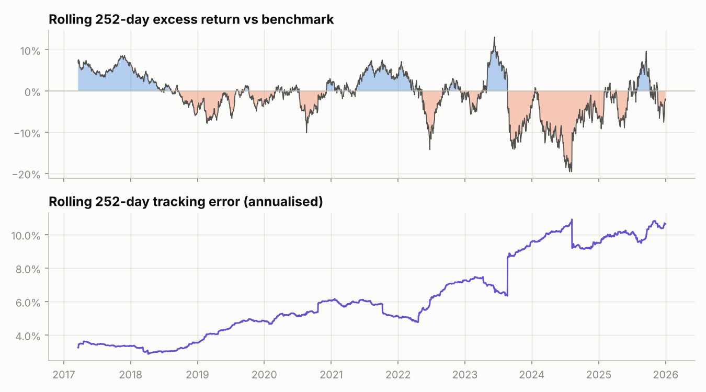
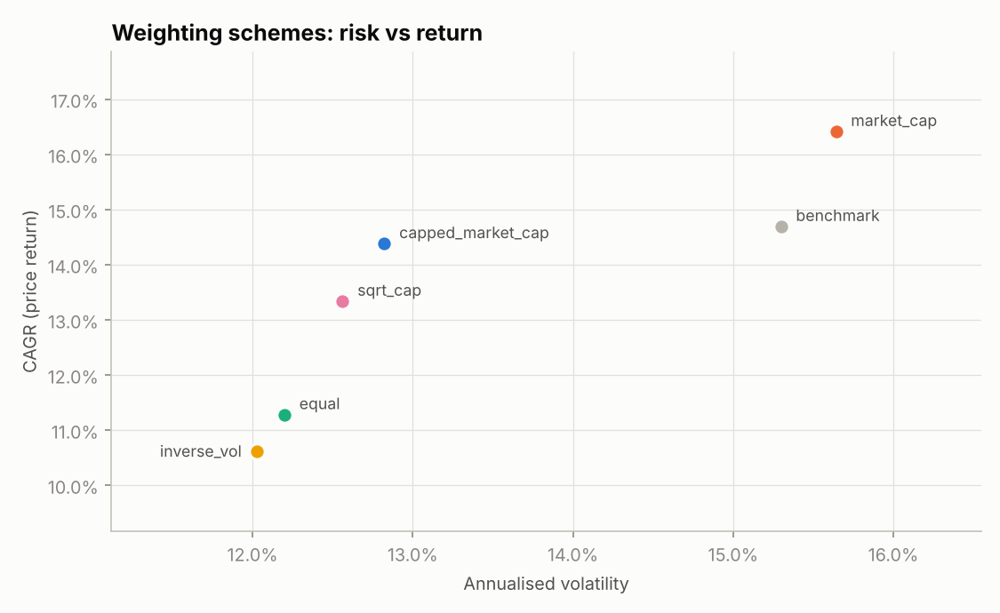
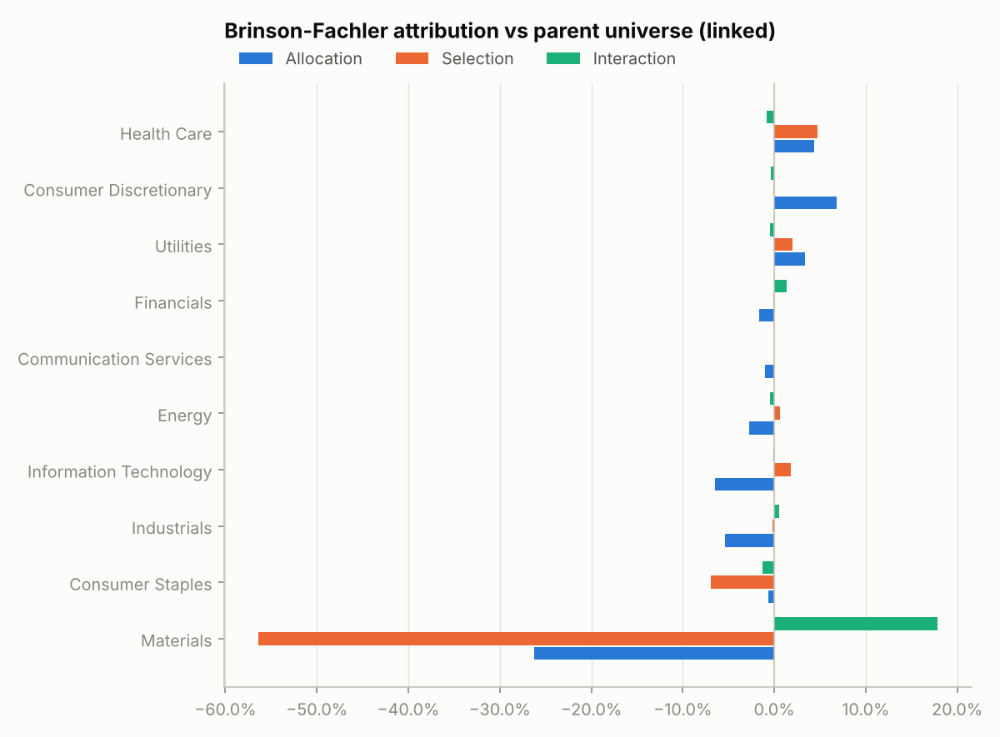
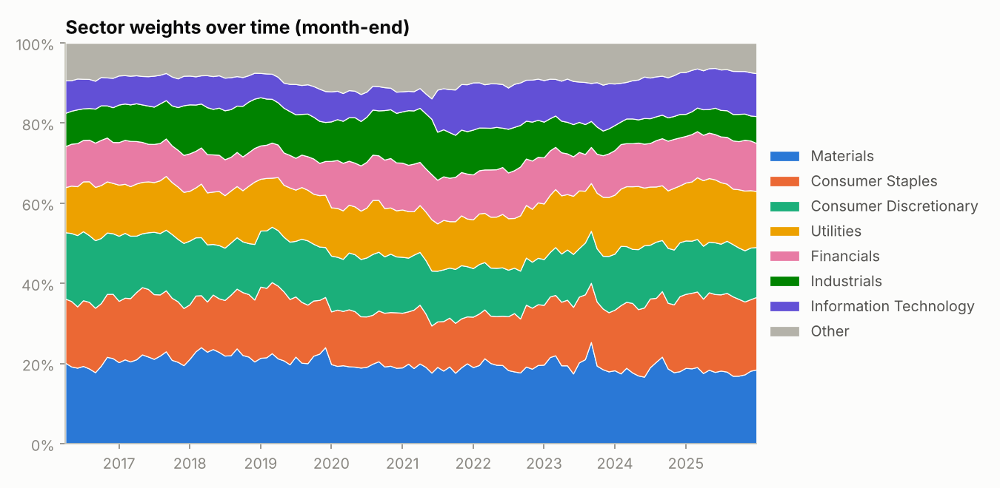
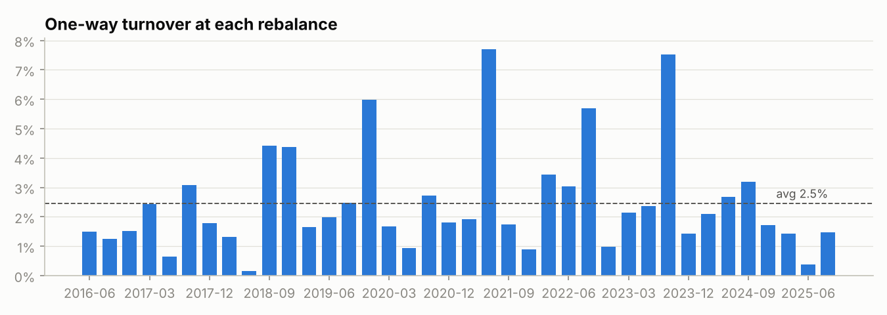

# India Large-Cap 40 — Backtest Report

> **Data source: SYNTHETIC.** Simulated multi-factor market used to demonstrate and test the engine. Run with `--source yahoo` for real NSE data.

**Period:** 2016-03-31 → 2025-12-31 · **Rebalances:** 39 (quarterly) ·
**Index type:** capped free-float market-cap weighted · **Constituents:** 40 · **Weighting:** capped_market_cap on free-float market cap (simulated IWFs) (stock cap 10%, sector cap 35%) ·
**Costs:** 10 bps per unit traded · **Risk-free:** 6.5%

## Performance and risk

| Metric | Index PR | Index TR | Index NET | Benchmark PR |
|---|---:|---:|---:|---:|
| CAGR | 14.38% | 16.25% | 16.23% | 14.69% |
| Volatility (ann.) | 12.82% | 12.82% | 12.82% | 15.30% |
| Sharpe | 0.61 | 0.73 | 0.73 | 0.55 |
| Sortino | 0.86 | 1.05 | 1.05 | 0.79 |
| Max drawdown | -26.91% | -26.68% | -26.69% | -29.81% |
| Calmar | 0.53 | 0.61 | 0.61 | 0.49 |
| 1-day VaR 95% | 1.14% | 1.13% | 1.13% | 1.36% |
| 1-day CVaR 95% | 1.76% | 1.75% | 1.75% | 2.08% |
| Skew | -0.33 | -0.33 | -0.33 | -0.02 |
| Excess kurtosis | 7.31 | 7.29 | 7.29 | 6.33 |
| Best month | 13.63% | 13.66% | 13.66% | 16.46% |
| Worst month | -19.60% | -19.60% | -19.60% | -21.32% |
| Beta | 0.75 | – | – | – |
| Jensen's alpha (ann.) | 1.47% | – | – | – |
| Correlation | 0.90 | – | – | – |
| Tracking error | 6.84% | – | – | – |
| Active return (CAGR diff) | -0.31% | – | – | – |
| Information ratio | -0.09 | – | – | – |
| Up capture | 0.77 | – | – | – |
| Down capture | 0.74 | – | – | – |
| Monthly hit rate | 57.26% | – | – | – |

Relative statistics compare the **price-return** index with the **price-return** benchmark, so dividends do not flatter the comparison.

**Is the active return statistically meaningful?** A moving-block bootstrap (2,000 resamples, 20-day blocks) puts the annualised active return at
-0.62% with a 95% interval of [-4.94%, 3.22%]; 37% of resamples are positive.

**Worst drawdown (TR):** -26.7%, peak 2019-06-26 → trough 2019-08-14, recovered 2020-12-30.

## Calendar-year returns

| Year | PR | TR | NET | Benchmark |
|---|---:|---:|---:|---:|
| 2016 | -1.02% | 0.26% | 0.25% | -5.20% |
| 2017 | 2.01% | 3.78% | 3.76% | -5.31% |
| 2018 | 41.35% | 43.75% | 43.72% | 47.60% |
| 2019 | -9.94% | -8.42% | -8.44% | -6.83% |
| 2020 | 19.41% | 21.41% | 21.40% | 17.14% |
| 2021 | 10.57% | 12.39% | 12.36% | 5.89% |
| 2022 | 33.94% | 36.18% | 36.14% | 34.80% |
| 2023 | 36.73% | 38.99% | 38.95% | 41.61% |
| 2024 | 0.29% | 2.00% | 1.98% | 4.87% |
| 2025 | 24.55% | 26.72% | 26.72% | 30.16% |

## Weighting-scheme comparison

Same universe, selection rules and rebalance calendar; only the weighting changes.

| Scheme | cagr | volatility | sharpe | max_drawdown | tracking_error | information_ratio | beta | avg_turnover | avg_effective_n |
|---|---:|---:|---:|---:|---:|---:|---:|---:|---:|
| capped_market_cap | 14.38% | 12.82% | 0.61 | -26.91% | 6.84% | -0.09 | 0.75 | 2.46% | 19.91 |
| market_cap | 16.41% | 15.64% | 0.63 | -29.82% | 2.74% | 0.56 | 1.01 | 0.48% | 11.01 |
| equal | 11.28% | 12.20% | 0.40 | -27.36% | 9.58% | -0.36 | 0.62 | 5.57% | 40.00 |
| inverse_vol | 10.62% | 12.02% | 0.36 | -27.04% | 9.81% | -0.41 | 0.60 | 5.82% | 38.24 |
| sqrt_cap | 13.34% | 12.56% | 0.54 | -27.06% | 6.70% | -0.23 | 0.74 | 2.95% | 28.68 |
| benchmark | 14.69% | 15.30% | 0.55 | -29.81% | – | – | – | – | – |

## Sector exposure and attribution

Brinson-Fachler attribution of the index against its **parent universe** (all eligible names, uncapped float-cap weights), per holding period, Carino-linked.
Index 288.18% vs parent 355.82% → active -67.65% =
allocation -29.43% + selection -54.54% + interaction 16.32% (residual -7.0e-15).

| Sector | allocation | selection | interaction | total |
|---|---:|---:|---:|---:|
| Health Care | 4.40% | 4.72% | -0.81% | 8.31% |
| Consumer Discretionary | 6.82% | -0.14% | -0.36% | 6.31% |
| Utilities | 3.36% | 2.01% | -0.42% | 4.94% |
| Financials | -1.60% | -0.08% | 1.34% | -0.34% |
| Communication Services | -1.01% | 0.00% | 0.00% | -1.01% |
| Energy | -2.71% | 0.67% | -0.43% | -2.47% |
| Information Technology | -6.46% | 1.85% | -0.11% | -4.72% |
| Industrials | -5.34% | -0.21% | 0.54% | -5.02% |
| Consumer Staples | -0.68% | -6.96% | -1.26% | -8.90% |
| Materials | -26.20% | -56.40% | 17.84% | -64.75% |

## Constituent contribution (price return, cumulative)

Top 10

| Stock | sector | contribution | avg_weight | days_in_index |
|---|---:|---:|---:|---:|
| ULTRACEMCO | Materials | 34.35% | 10.26% | 2545 |
| TITAN | Consumer Discretionary | 19.84% | 9.46% | 2545 |
| NTPC | Utilities | 19.36% | 9.94% | 2545 |
| TATACONSUM | Consumer Staples | 9.10% | 7.51% | 2545 |
| BHARTIARTL | Communication Services | 8.95% | 4.28% | 2545 |
| DABUR | Consumer Staples | 6.72% | 3.17% | 2545 |
| SHRIRAMFIN | Financials | 5.97% | 1.96% | 2545 |
| SHREECEM | Materials | 4.97% | 3.61% | 2545 |
| LT | Industrials | 4.96% | 2.96% | 2545 |
| POWERGRID | Utilities | 4.61% | 2.32% | 2545 |

Bottom 5

| Stock | sector | contribution | avg_weight | days_in_index |
|---|---:|---:|---:|---:|
| KOTAKBANK | Financials | -1.15% | 1.23% | 978 |
| MARUTI | Consumer Discretionary | -1.10% | 0.65% | 2545 |
| M&M | Consumer Discretionary | -0.83% | 0.58% | 1369 |
| RELIANCE | Energy | -0.83% | 1.48% | 2545 |
| HDFCLIFE | Financials | -0.60% | 0.79% | 2545 |

## Rebalancing

Most recent rebalances (full log in `rebalance_log.csv`):

| Rebalance | n | eligible | adds | dels | additions | deletions | one_way_turnover | cost_bps | divisor |
|---|---:|---:|---:|---:|---:|---:|---:|---:|---:|
| 2024-06-28 | 40 | 52 | 0 | 0 |  |  | 2.69% | 0.54 | 64433176123.79 |
| 2024-09-30 | 40 | 52 | 0 | 0 |  |  | 3.19% | 0.64 | 62243160209.65 |
| 2024-12-31 | 40 | 52 | 0 | 0 |  |  | 1.72% | 0.34 | 63251894400.13 |
| 2025-03-31 | 40 | 52 | 0 | 0 |  |  | 1.44% | 0.29 | 63589061526.58 |
| 2025-06-30 | 40 | 52 | 0 | 0 |  |  | 0.38% | 0.08 | 63590622933.42 |
| 2025-09-30 | 40 | 52 | 0 | 0 |  |  | 1.47% | 0.29 | 62780884179.35 |

Current top 15 holdings (full list in `current_constituents.csv`):

| Ticker | sector | target_weight | current_weight | capping_factor |
|---|---:|---:|---:|---:|
| NTPC | Utilities | 10.00% | 10.54% | 0.70 |
| ULTRACEMCO | Materials | 10.00% | 10.53% | 0.13 |
| TITAN | Consumer Discretionary | 10.00% | 9.66% | 0.56 |
| TATACONSUM | Consumer Staples | 10.00% | 7.69% | 0.90 |
| HCLTECH | Information Technology | 5.20% | 5.30% | 1.00 |
| DABUR | Consumer Staples | 4.37% | 5.02% | 1.00 |
| SHRIRAMFIN | Financials | 3.89% | 4.51% | 1.00 |
| BHARTIARTL | Communication Services | 3.53% | 3.88% | 1.00 |
| SHREECEM | Materials | 2.67% | 3.67% | 1.00 |
| POWERGRID | Utilities | 4.06% | 3.03% | 1.00 |
| LT | Industrials | 2.87% | 2.99% | 1.00 |
| DRREDDY | Health Care | 2.40% | 2.45% | 1.00 |
| LTIM | Information Technology | 2.05% | 2.13% | 1.00 |
| SBILIFE | Financials | 2.50% | 2.12% | 1.00 |
| TECHM | Information Technology | 2.01% | 2.01% | 1.00 |

## Validation

Every run reconciles its own outputs; failures are logged and shown here. Unit tests (`pytest`) separately check the logic on controlled inputs.

| Check | Result | Detail |
|---|---|---|
| Weights sum to 100% | ✅ pass | max abs(Σw − 1) over 2,545 days and 39 rebalances |
| Single-stock cap respected | ✅ pass | largest target weight 10.0000% vs cap 10% |
| Sector cap respected | ✅ pass | largest sector target 23.7725% vs cap 35% |
| Divisor keeps level continuous | ✅ pass | max relative gap between old-basket and new-basket level at each rebalance |
| Dividends reconcile (TR − PR) | ✅ pass | max daily gap vs dividends rebuilt from holdings; dividend yield ≈ 1.62%/yr |
| Costs reconcile (NET vs TR) | ✅ pass | cumulative cost drag 0.187% from 38 rebalances |
| Attribution sums to active return | ✅ pass | allocation + selection + interaction − active = -7.0e-15 |
| Attribution index return = PR level | ✅ pass | 288.1793% vs 288.1793% |
| Selection uses lagged data | ✅ pass | minimum lag 5 trading days (required ≥ 5) |

## Data provenance and limitations

| Input | Basis in this run |
|---|---|
| Universe | fixed candidate list of current large caps (not historical index membership) (56 candidates with data) |
| Weighting basis | free-float market cap (simulated IWFs) |
| Index weight resting on point-in-time share counts (avg. over rebalances) | 100.0% |
| … on back-filled share counts (look-ahead) | 0.0% |
| … on today's share count used for past dates (look-ahead) | 0.0% |
| Index weight with a known (non-default) IWF | 100.0% |
| Prices, volumes, liquidity screen | daily, point-in-time (split-adjusted closes) |
| Excluded (no data) | none |

Limitations:

- **Survivorship bias.** The candidates are today's large caps, so companies that were large in 2016 but later shrank or delisted are missing. Treat results as a fixed-candidate-universe study, not a reconstruction of a historical index.
- **Free float.** Simulated IWFs.
- **Share counts.** Where a stock's weight rests on back-filled or current share counts (above), its historical weight uses information that was not available at the time.
- **Benchmark.** NIFTY 50 price return; a dividend-inclusive comparison needs the NIFTY 50 TRI.
- **Corporate actions.** Splits via split-adjusted prices; spin-offs and rights issues are not modelled.

Run log: `run_log.json` (2026-10-27T23:05:17+00:00, checks passed 9/9, config hash `d8989fa13d971f83`).
